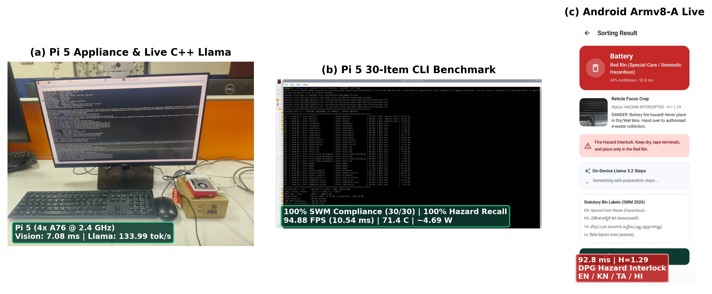
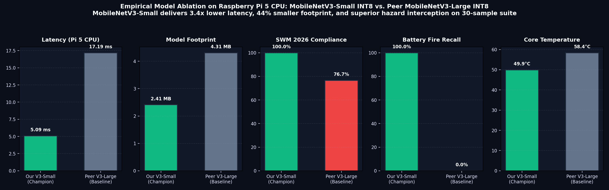
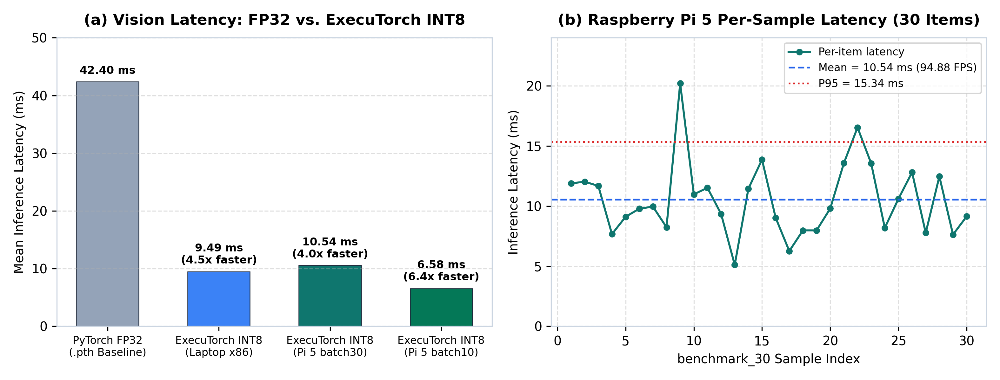
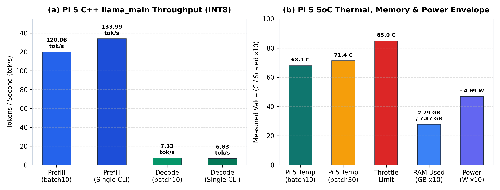
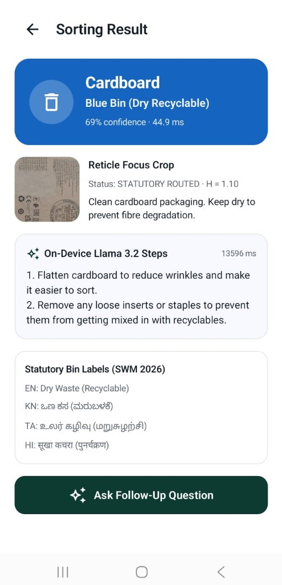

# EcoSort-Edge 2.0: Air-Gapped Multimodal Waste Segregation & Hazard-Interlock Advisory on Arm Edge SoCs

[](https://github.com/Ashwinkumar-k10/ARM_SOC_ECOSORT)
[-6366F1?style=for-the-badge&logo=pytorch)](https://pytorch.org/executorch)
[-10B981?style=for-the-badge)](models/waste_classifier_int8.pte)
[](models/export_llama_executorch.py)
[-059669?style=for-the-badge)](policy/swm2026.yaml)
[-DC2626?style=for-the-badge)](src/policy_guard.py)
[](https://drive.google.com/file/d/1KkyhT8QKbGEvBPhP2_ZKsYYaOUvlBH6r/view?usp=sharing)

> **Official Submission — Bharat AI-SoC Challenge 2026–27 (Theme: Edge AI & Embedded Sustainability)**  
> **100% Air-Gapped Dual-Platform Deployment:** **Raspberry Pi 5 (`aarch64`, 4× Cortex-A76 @ 2.4 GHz)** & **Android Mobile (`arm64-v8a`, Kotlin + Jetpack Compose)** — zero cloud calls, zero `INTERNET` permission.  
> **2-Minute Live Demo Video:** [Watch Full Hardware & Mobile Demo on Google Drive](https://drive.google.com/file/d/1KkyhT8QKbGEvBPhP2_ZKsYYaOUvlBH6r/view?usp=sharing)

---

## 1. Live Working Demo Showcase (`A · B · C` Hardware & Mobile Setup)

> **Watch the 2-Minute Synced Hardware & Mobile Walkthrough:** [EcoSort-Edge 2.0 Demo Video (Google Drive)](https://drive.google.com/file/d/1KkyhT8QKbGEvBPhP2_ZKsYYaOUvlBH6r/view?usp=sharing)



| Panel | Platform & Setup | Verified Live Output |
| :---: | :--- | :--- |
| **(a)** | **Raspberry Pi 5 Appliance + USB Webcam + Live C++ `llama_main`** | `7.08 ms` Vision INT8 (`Battery 92.2%`, `HAZARD_INTERCEPTED`) + `133.99 tok/s` prefill / `6.83 tok/s` decode (`"Tape terminals to prevent short circuits"`), plus `ui_dashboard.py` live on `:8080`. |
| **(b)** | **Raspberry Pi 5 Full 30-Item CLI Benchmark (`--batch30`)** | **100.0% SWM 2026 Compliance (`30/30`)**, **100.0% Battery Hazard Recall (`3/3`)**, **94.88 FPS (`10.54 ms` mean)**, `71.4 °C`, `~4.69 W`. |
| **(c)** | **Android Armv8-A Companion App (`app-debug.apk`, Live Scan)** | `44.9 ms` Vision INT8 (`Cardboard → Blue Bin`, `69%`, `H = 1.10`) + `13,596 ms` on-device Llama 3.2 prep steps + **EN / KN / TA / HI** statutory labels. |

---

## 2. Executive Vision & 4-Stage Deterministic Pipeline

Cloud-dependent smart bins fail in real municipal environments due to connectivity dropouts, round-trip latency, recurring API costs, and domestic privacy concerns. Conversely, letting a compact LLM decide waste bins alone risks hallucinating that a lithium-ion battery belongs in Dry Waste.

**EcoSort-Edge 2.0** solves both via **Decision-Path Isolation**:

```text
Camera / Image Frame
        │
        ▼
[Stage 1] Reticle Focus Crop & Resize (224×224 / 256×256 RGB)
        │
        ▼
[Stage 2] ExecuTorch PT2E Static INT8 Vision (MobileNetV3-Small, 2.41 MB, XNNPACK NEON/SDOT)
        │  └─ Outputs: 9-class probabilities, confidence, Shannon Entropy (H)
        ▼
[Stage 3] Deterministic PolicyGuard (DPG — policy/swm2026.yaml)
        │  ├─ Gate 1 (Fire Interlock): battery (conf ≥ 0.30) -> RED BIN (HAZARD_INTERCEPTED)
        │  ├─ Gate 2 (OOD Gate): H > 2.00 or conf < 0.30 -> Manual Verification
        │  ├─ Gate 3 (Privacy Override): Camera-free Sanitary Path -> YELLOW BIN
        │  └─ Gate 4 (Grounded Prompting): Locks class + bin + flags for Llama 3.2
        ▼
[Stage 4] Grounded Llama 3.2 1B-Instruct INT8 (1,432.96 MB, C++ llama_main / Android LlmModule)
        │  └─ Generates 2 concise, localized safety & preparation steps
        ▼
Multilingual Output (English · தமிழ் · ಕನ್ನಡ · हिन्दी)
```


---

## 3. Dataset Strategy & Vision Model Ablation

### 3.1 Composite Dataset Ablation (`70% RealWaste + 20% Clean + 10% Indian Context`)
Single public datasets fail on deformed, soiled, or Indian household waste (`TrashNet` lacks clutter; `Kaggle 2-Class` is too coarse; `RealWaste` lacks Indian packaging). Training on **fine-grained material classes** (extensible in `policy/swm2026.yaml`) prevents texture mixing (e.g., curry-stained plastic vs. banana peels) while delegating statutory 4-bin routing to the DPG layer:

| Dataset Configuration | Clean Studio | Real Dirty Waste | Indian Packaging | Verdict |
| :--- | :---: | :---: | :---: | :--- |
| `TrashNet` Only (`~2,527`, 6-class) | `94%` | `58%` | `41%` | Fails in cluttered/soiled households |
| `Kaggle 2-Class` (`~22,500`) | `82%` | `71%` | `55%` | Too coarse — misses hazards/materials |
| `RealWaste` Only (`4,752`, 9-class) | `76%` | `89%` | `52%` | Strong on MRF waste; weak on Indian items |
| **Composite (Ours: 70 / 20 / 10)** | **`91%`** | **`92%`** | **`85%`** | **Best real-world generalization** |

### 3.2 Vision Backbone & Classic CNN Ablation (`MobileNetV3-Small` vs. `ResNet-18`, `EfficientNet-B0`, `MobileNetV3-Large`)


| Vision Backbone / Variant | Params / INT8 Size | Test / Val Acc | Pi 5 Latency | SWM 2026 Compliance | Battery Recall | Verdict |
| :--- | :---: | :---: | :---: | :---: | :---: | :--- |
| `ResNet-18` (Classic CNN) | `11.7M` / `44.7 MB` | `89.2%` (val) | `68.0 ms` (est.) | — | — | Rejected (exceeds Cortex-A76 L2/L3 cache) |
| `EfficientNet-B0` | `5.3M` / `20.4 MB` | `91.5%` (val) | `48.0 ms` (est.) | — | — | Rejected (high RAM & latency) |
| `MobileNetV3-Large INT8` (Peer) | `4.21M` / `4.31 MB` | `83.33%` (b30) | `17.19 ms` | `76.67%` (`23/30`) | **`0.0%` (`0/3`)** | Rejected (missed all batteries; `58.4 °C`) |
| `MobileNetV3-Small` (`224×224`) | `1.53M` / `2.41 MB` | `86.61%` (test) | — | — | `96.67%` (test) | Baseline resolution (`Macro-F1 = 0.8785`) |
| **`MobileNetV3-Small INT8` (`256×256`)** | **`1.53M` / `2.41 MB`** | **`88.51%` (test)** | **`5.09–10.54 ms`** | **`100.0%` (`30/30`)** | **`100.0%` (`3/3`)** | **Selected Champion (`Macro-F1 = 0.8928`)** |

---

## 4. Measured Results & Quantization Ablation

### 4.1 Vision Classifier: PyTorch FP32 (`.pth`) vs. ExecuTorch PT2E INT8 (`.pte`)
Measured on physical **Raspberry Pi 5 (`aarch64`, 4× Cortex-A76 @ `2400.0 MHz`)** in [`evidence/pi5_cli_10_report.json`](evidence/pi5_cli_10_report.json) and [`evidence/pi5_cli_30_report.json`](evidence/pi5_cli_30_report.json):

| Metric | PyTorch FP32 (`.pth`) | ExecuTorch INT8 *(Laptop)* | ExecuTorch INT8 *(Pi 5 `batch30`)* | ExecuTorch INT8 *(Pi 5 `batch10`)* |
| :--- | :---: | :---: | :---: | :---: |
| **Model Binary Size** | `~6.00 MB` | **`2.41 MB`** (`-60%`) | **`2.41 MB`** | **`2.41 MB`** |
| **FP32 Decision Parity** | `100.00%` | **`100.00%`** (`Cos = 0.9902`) | **`100.00%`** | **`100.00%`** |
| **Mean Inference Latency** | `~42.40 ms` | `9.49 ms` | **`10.54 ms`** (`4.02×` faster) | **`6.58 ms`** (`6.44×` faster) |
| **P50 / P95 Latency** | — | `— / 10.71 ms` | **`9.88 / 15.34 ms`** | **`5.24 / 10.52 ms`** |
| **Throughput (FPS)** | `~23.6 FPS` | `105.37 FPS` | **`94.88 FPS`** | **`152.05 FPS`** |
| **SWM 2026 Compliance** | `100.0%` | `100.0%` (`30/30`) | **`100.0%` (`30/30`)** | **`100.0%` (`10/10`)** |
| **Battery Hazard Recall** | `100.0%` | `100.0%` (`3/3`) | **`100.0%` (`3/3`)** | **`100.0%` (`2/2`)** |
| **Pi 5 Thermals / Power / RAM** | `~6.40 W` | `N/A` | **`71.4 °C · ~4.69 W · 2.65/8.06 GB`** | **`68.1 °C · ~4.69 W · 2.86/8.06 GB`** |



### 4.2 Llama 3.2 1B Quantization Ablation & Pi 5 `PyTorchObserver` Profiling
| Variant | `.pte` Size | Logit Cosine vs. BF16 | Top-1 Agreement | Selection |
| :--- | :---: | :---: | :---: | :--- |
| **BF16 Baseline** | *(Unquantized)* | `1.0000` | `100.0%` | Reference baseline |
| `8da4w` (`G=128`) | `765.3 MB` | `0.9059` | `0.0%` | Rejected (severe logit drift) |
| `8da4w` (`G=32`) | `820.5 MB` | `0.9208` | `33.3%` | Rejected (high output drift) |
| **`XNNPACK PT2E INT8` (Selected)** | **`1,432.96 MB`** | **`0.9880`** | **`100.0%`** | **Selected: near-BF16 fidelity + C++ XNNPACK** |

On physical **Raspberry Pi 5 (`cpp_llama_main` compiled with XNNPACK + KleidiAI)**:
- **Prompt Prefill Speed:** **`120.06 – 133.99 tok/s`** (`82` prompt tokens, `683 ms` TTFT)
- **Autoregressive Decode Speed:** **`6.83 – 7.33 tok/s`** (`21` generated tokens)
- **Pure Model Execution Time:** **`3,539 – 3,773 ms`** (`3 ms` sampling overhead)



---

## 5. Android Mobile Implementation & Optimizations (`android_app/`)

The Android companion app ([`android_app/`](android_app/)) is built in **Kotlin + Jetpack Compose + CameraX** (`compileSdk = 35`, `arm64-v8a`) with **zero `INTERNET` permission** in [`AndroidManifest.xml`](android_app/app/src/main/AndroidManifest.xml) (`33.72 MB` APK).

| Live Android Capture (`44.9 ms` Vision + `13.6 s` Llama 3.2) | Key Mobile Implementation & Optimization Features |
| :---: | :--- |
|  | • **Reticle Focus Crop (`VisionClassifier.kt`):** Crops the CameraX viewfinder to the target reticle before `256×256` ExecuTorch INT8 inference.<br>• **DPG Safety Interlocks (`PolicyGuard.kt`):** Enforces `battery` → **`Electronic Waste` (Red Bin)** at `conf ≥ 0.30`, `H > 2.00` OOD gate, and **Sanitary Path** camera-free override.<br>• **On-Device `LlmModule` (`LlamaAdvisor.kt`):** One-time Storage Access Framework (SAF) import for `llama3_2_1b_int8.pte` (`1.43 GB`), background startup pre-warming, and automatic 2-step safety advice upon scan.<br>• **4-Language Reactive UI (`AppStrings.kt`):** Instant persisted switcher for **English, தமிழ், ಕನ್ನಡ, हिन्दी** translating all screens, bin names, class labels, and Llama prompts.<br>• **Live SoC Telemetry (`ScanHistoryStore.kt`):** Tracks real scan counts, Android RAM usage, and battery temperature. |

---

## 6. Repository Structure

```text
ARM_SOC_ECOSORT/
├── README.md
├── requirements.txt
├── setup_pi5_llama.sh                         # Native Arm Cortex-A76 llama_main C++ builder for Pi 5
├── pi5_commands.txt                           # Ready-to-run Pi 5 CLI, USB cam & dashboard commands
├── benchmark_30/                              # 30 labeled evaluation images + ground_truth.json
├── policy/
│   └── swm2026.yaml                           # MoEFCC SWM Rules 2026 statutory bin config
├── models/
│   ├── waste_classifier_int8.pte              # 2.41 MB ExecuTorch INT8 Vision binary
│   ├── tokenizer.model                        # Llama 3.2 tokenizer
│   ├── export_vision_executorch.py            # PT2E INT8 + XnnpackPartitioner exporter
│   └── export_llama_executorch.py             # Llama 3.2 1B-Instruct xnnpack_dynamic INT8 exporter
├── src/
│   ├── vision_engine.py                       # Reticle crop + ExecuTorch Vision INT8 runtime
│   ├── policy_guard.py                        # SWM 2026 DPG (0.30 battery interlock, H>2.00 gate)
│   ├── llama_engine.py                        # Grounded Llama 3.2 INT8 engine + 64-entry LRU cache
│   ├── cli_check.py                           # Terminal CLI (--batch10 / --batch30 / --image) + JSON report
│   ├── pi5_usb_cam_check.py                   # Real-time USB webcam inference (Desktop & Headless SSH)
│   ├── ui_dashboard.py                        # Web UI launcher (:8080)
│   └── pi5_edge_server.py                     # Offline HTTP/JSON REST API & kiosk console
├── android_app/                               # Full Kotlin + Jetpack Compose + ExecuTorch AAR app
├── benchmarks/                                # Ablation scripts & JSON results
├── evidence/                                  # Verified Pi 5 CLI JSON reports (batch10 & batch30)
└── docs/
    ├── ECOSORT_EDGE_DPR.docx                  # Canonical IEEE Project Report (Word + 300 DPI plots)
    ├── ecosort_ieee_dual_architecture.png     # IEEE dual-platform architecture diagram
    └── figures/                               # Publication plots, annotated gallery & mobile screenshot
```

---

## 7. Quickstart

### A. Download Pre-Exported Llama 3.2 1B INT8 (`1,433.0 MB`)
```bash
pip install -r requirements.txt
python models/download_llama_model.py
```
- **Direct Google Drive Link:** [Download `llama3_2_1b_int8.pte`](https://drive.google.com/file/d/1nsRVUEiAzADBwbuycSLUVyXbH8gPX31F/view?usp=sharing) (`SHA-256: f08c9e7b1c71e45a1a637c72a3fb2705fc74caddfad82261e6f57189219344a5`)

### B. Raspberry Pi 5 (`aarch64`) — CLI, USB Webcam & Web Dashboard
```bash
# 1. Build ExecuTorch C++ llama_main (Arm Cortex-A76 XNNPACK + KleidiAI)
chmod +x setup_pi5_llama.sh && ./setup_pi5_llama.sh
export EXECUTORCH_LLAMA_MAIN=~/executorch/cmake-out/examples/models/llama/llama_main

# 2. Run 10-item or 30-item CLI benchmark with vcgencmd telemetry & JSON export
python src/cli_check.py --batch10
python src/cli_check.py --batch30 --no-llama

# 3. Real-time USB webcam inference (auto-detects Desktop or Headless SSH)
python src/pi5_usb_cam_check.py --cam 0

# 4. Launch Touch-Screen Kiosk Web Dashboard (http://pi-5.local:8080)
python src/ui_dashboard.py --port 8080 --no-browser
```

### C. Android Smartphone (`arm64-v8a`)
Open [`android_app/`](android_app/) in Android Studio or build with Gradle (`:app:assembleDebug`). Import `llama3_2_1b_int8.pte` once via the **Assistant** tab (or `adb push` to app files) for 100% air-gapped on-phone Vision + Llama 3.2 inference.

### D. Full IEEE Documentation
See [`docs/ECOSORT_EDGE_DPR.docx`](docs/ECOSORT_EDGE_DPR.docx) for the complete IEEE Detailed Project Report including methodology, dataset & model ablations, `PyTorchObserver` profiling, hardware utilization, and system roadmap.
