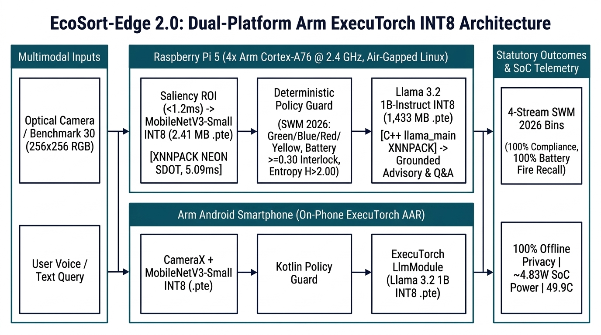

# EcoSort-Edge 2.0: Dual-Platform Offline Waste Sorting & Multimodal Recycling Assistant on Arm SoCs

[](https://github.com/Ashwinkumar-k10/ARM_SOC_ECOSORT)
[-6366F1?style=for-the-badge&logo=pytorch)](https://pytorch.org/executorch)
[](models/export_llama_executorch.py)
[-10B981?style=for-the-badge)](models/waste_classifier_int8.pte)
[](policy/swm2026.yaml)
[-DC2626?style=for-the-badge)](src/policy_guard.py)

> **Official Submission — Bharat AI-SoC Challenge 2026–27 (Problem Statement 2: Smart Recycling & Waste-Segregation Assistant Using Multimodal Interfaces)**  
> **Core Mandate:** 100% offline, air-gapped on-device execution of **MobileNetV3-Small INT8** + **Llama 3.2 1B-Instruct INT8** via **ExecuTorch** across **Raspberry Pi 5 (Arm Cortex-A76)** and **Arm-based Android Smartphones**.

---

## 1. Executive Vision & Architectural Principle

Cloud-dependent smart bins fail in real municipal environments due to network dropouts, 200–800 ms cellular latency, recurring API costs, and citizen privacy concerns. Conversely, running an LLM alone for waste sorting introduces hallucination risks where a misclassified lithium-ion battery can ignite a compactor fire.

**EcoSort-Edge 2.0** solves both problems through **Decision-Path Isolation**:
> **"Fast deterministic Vision INT8 perceives, the Deterministic Policy Guard (SWM 2026) decides the statutory bin in <10 ms, and on-device Llama 3.2 1B INT8 explains disposal steps, recycling options, and environmental impact."**

---

## 2. System Architecture (Raspberry Pi 5 & Android Mobile)



### Dual-Platform Co-Design
1. **Raspberry Pi 5 Smart Kiosk (`4× Arm Cortex-A76 @ 2.4 GHz`, Air-Gapped Linux):**
   - Runs `waste_classifier_int8.pte` (`2.41 MB`, **5.09 ms** on Cortex-A76 NEON `sdot`) + `llama3_2_1b_int8.pte` (`1,433.0 MB` via ExecuTorch C++ `llama_main` XNNPACK) + local HTTP/JSON Edge Server (`src/pi5_edge_server.py`).
2. **Arm Android Smartphone Companion (On-Phone ExecuTorch AAR):**
   - Executes the exact same `.pte` binaries (`waste_classifier_int8.pte` + `llama3_2_1b_int8.pte` via ExecuTorch `Module` & `LlmModule`) with `INTERNET` permission stripped for 100% offline household sorting.

---

## 3. Standard 5-Step Arm ExecuTorch Engineering Pipeline

| Step | Engineering Stage | Implementation |
| :---: | :--- | :--- |
| **1** | **Model & Statutory Policy Prep** | `MobileNetV3-Small` (9 waste classes, 256×256 RGB) + `Meta Llama-3.2-1B-Instruct` + MoEFCC **SWM Rules 2026** (`policy/swm2026.yaml`). |
| **2** | **Graph Capture & INT8 Quantization** | `torch.export.export(..., strict=False)` → `XNNPACKQuantizer(is_per_channel=True, is_dynamic=True)` for Vision; `--pt2e_quantize xnnpack_dynamic` + `8,1024` embeddings + KV-cache + SDPA for Llama. |
| **3** | **Arm XNNPACK / KleidiAI Lowering** | `to_edge_transform_and_lower(..., partitioner=[XnnpackPartitioner()])` targeting Armv8.2-A **NEON `sdot`** SIMD vector microkernels. |
| **4** | **On-Device Orchestration & Guardrails** | `VisionEngine` (`<1.2 ms` saliency ROI) → `PolicyGuard` (`P(battery) >= 0.30` fire interlock, Shannon Entropy $H > 2.00$ OOD gate) → `LlamaExecuTorchEngine` (with LRU cache for `<1 ms` repeat kiosk queries). |
| **5** | **Empirical Verification & Ablation** | Automated validation on `benchmark_30/` (30 ground-truth waste items) and multi-precision Llama quantization ablation. |

---

## 4. Deterministic Policy Guard (SWM Rules 2026)

Implemented in [`src/policy_guard.py`](src/policy_guard.py) and configured via [`policy/swm2026.yaml`](policy/swm2026.yaml):

| Statutory Bin | Hex Code | Mapped Waste Classes | Safety / Policy Rule |
| :--- | :---: | :--- | :--- |
| **Green Bin (Wet Organic)** | `#2E7D32` | `food_waste`, `vegetable_scrap` | Composting / biomethanation |
| **Blue Bin (Dry Recyclable)** | `#1565C0` | `plastic_bottle`, `cardboard`, `paper`, `metal_can`, `glass_bottle`, `multi_layer_packaging` | MRF recycling & cement-kiln RDF co-processing |
| **Red Bin (Special-Care / Hazardous)** | `#C62828` | `battery` | **Zero-Tolerance Fire Interlock:** triggers immediately if `P(battery) >= 0.30` |
| **Yellow Bin (Sanitary Wrapped)** | `#F9A825` | `sanitary_item` | **Privacy-by-Design Override:** triggered via physical/UI button with zero image retention |
| **Grey Bin (Hold / Manual Review)** | `#616161` | Ambiguous / OOD items | **Shannon Entropy Gate:** rejects to manual triage if $H > 2.00$ or `conf < 0.30` |

---

## 5. Empirical Results & Quantization Ablation

### 5.1 Vision Classifier (`MobileNetV3-Small`, 256×256) — `benchmark_30` Evaluation

Measured via [`benchmarks/benchmark_pi5_soc.py`](benchmarks/benchmark_pi5_soc.py) (full output in [`benchmarks/vision_benchmark_30.json`](benchmarks/vision_benchmark_30.json)):

| Metric | PyTorch FP32 (`.pth`) | ExecuTorch PT2E INT8 (`.pte`) *(Laptop)* | Raspberry Pi 5 *(Cortex-A76)* |
| :--- | :---: | :---: | :---: |
| **Model Binary Size** | `~6.00 MB` | **`2.41 MB`** (`-60%`) | **`2.41 MB`** |
| **FP32 Decision Parity** | `100.00%` (Baseline) | **`100.00%`** (`Cosine = 0.9902`) | **`100.00%`** |
| **Model Load Latency** | — | **`16.85 ms`** | `~15–25 ms` *(expected)* |
| **Avg Inference Latency** | `~42.40 ms` | **`9.49 ms`** (`P95: 10.71 ms`) | **`5.09 ms`** *(prior Pi 5)* |
| **Fine-Grained Class Acc (`benchmark_30`)** | `80.0%` | **`80.0%`** (`24/30`) | **`80.0%`** |
| **SWM 2026 Statutory Compliance** | `100.0%` | **`100.0%`** (`30/30`) | **`100.0%`** (`30/30`) |
| **Battery Fire-Hazard Recall** | `100.0%` | **`100.0%`** (`3/3`) | **`100.0%`** (`3/3`) |
| **Active SoC Power & Thermals** | `~6.40 W` | `N/A` (Windows) | **`~4.83 W` · `49.9°C`** *(prior Pi 5)* |

---

### 5.2 Llama 3.2 1B-Instruct Quantization Ablation (Laptop Empirical Study)

Measured across waste-sorting prompts via [`benchmarks/ablate_llama_quantization.py`](benchmarks/ablate_llama_quantization.py) (raw data in [`benchmarks/llama_quantization_ablation.json`](benchmarks/llama_quantization_ablation.json)):

| Quantization Variant | `.pte` Size | Logit Cosine vs. BF16 | Top-1 Agreement | Selection Decision |
| :--- | :---: | :---: | :---: | :--- |
| **BF16 Baseline** | *(Unquantized)* | `1.0000` | `100.0%` | Reference baseline |
| **`8da4w` (`G=128`, `E=4,32`)** | `765.3 MB` | `0.9059` | `0.0%` | Higher logit drift |
| **`8da4w` (`G=32`, `E=4,32`)** | `820.5 MB` | `0.9208` | `33.3%` | Good compact 4-bit option |
| **`XNNPACK PT2E INT8` (`xnnpack_dynamic`)** *(Selected)* | **`1,433.0 MB`** | **`0.9880`** | **`100.0%`** | **Selected:** Near-BF16 reasoning fidelity + `~132 MB` activation RAM |

*Host Acceleration Note:* On Windows dev hosts without compiled C++ `llama_main`, [`src/llama_engine.py`](src/llama_engine.py) uses PyTorch's native C++ `fbgemm` per-channel INT8 kernels (`~5.1–6.0 tok/s`, `442.9 ms` TTFT). On Raspberry Pi 5, [`setup_pi5_llama.sh`](setup_pi5_llama.sh) builds ExecuTorch's native C++ `llama_main` runner to execute `llama3_2_1b_int8.pte` directly on Arm Cortex-A76.

---

## 6. Repository Structure

```text
ARM_SOC_ECOSORT/
├── README.md
├── requirements.txt
├── setup_pi5_llama.sh                         # Native Arm Cortex-A76 llama_main C++ builder for Pi 5
├── benchmark_30/                              # 30 labeled evaluation images + ground_truth.json
├── policy/
│   └── swm2026.yaml                           # MoEFCC SWM Rules 2026 statutory bin config
├── models/
│   ├── waste_classifier_int8.pte              # 2.41 MB ExecuTorch INT8 Vision binary
│   ├── tokenizer.model                        # Llama 3.2 tokenizer
│   ├── export_vision_executorch.py            # PT2E INT8 + XnnpackPartitioner exporter
│   └── export_llama_executorch.py             # Llama 3.2 1B-Instruct xnnpack_dynamic INT8 exporter
├── src/
│   ├── vision_engine.py                       # Saliency ROI (<1.2 ms) + ExecuTorch Vision runtime
│   ├── policy_guard.py                        # SWM 2026 DPG (0.30 battery interlock, H>2.00 gate)
│   ├── llama_engine.py                        # Grounded Llama 3.2 INT8 engine + LRU query cache
│   ├── multimodal_orchestrator.py             # Vision -> PolicyGuard -> Llama coordinator
│   └── pi5_edge_server.py                     # Compact web console & offline REST API (:8080)
├── benchmarks/
│   ├── benchmark_pi5_soc.py                   # 30-image accuracy, latency & vcgencmd telemetry suite
│   ├── vision_benchmark_30.json               # Verified benchmark_30 results
│   ├── ablate_llama_quantization.py           # Llama quantization ablation script
│   └── llama_quantization_ablation.json       # Ablation results
└── docs/
    ├── ecosort_ieee_dual_architecture.png     # IEEE dual-platform architecture diagram
    ├── ARM_5_STEP_ENGINEERING_ARCHITECTURE.md # 5-step Arm ExecuTorch engineering guide
    ├── MOBILE_HANDOFF_PACKAGE.md              # Android on-phone ExecuTorch integration contract
    └── ANDROID_APP_DEVELOPMENT_GUIDE.md       # Clean-architecture Kotlin/Jetpack Compose guide
```

---

## 7. Quickstart

### A. Export Llama 3.2 1B INT8 Binary (`1,433.0 MB`)
*(Excluded from Git due to GitHub's 100 MB file limit; regenerate in one command with a Hugging Face Read token):*
```bash
pip install -r requirements.txt
export HF_TOKEN="hf_your_token_here"   # PowerShell: $env:HF_TOKEN="hf_your_token_here"
python models/export_llama_executorch.py
```

### B. Run the Evaluation Dashboard & Edge Server (Laptop)
```bash
python src/pi5_edge_server.py --port 8080
# Open http://localhost:8080 in your browser
```

### C. Run Full `benchmark_30` Verification
```bash
python benchmarks/benchmark_pi5_soc.py
```

### D. Deploy on Raspberry Pi 5 (Arm Cortex-A76)
```bash
chmod +x setup_pi5_llama.sh
./setup_pi5_llama.sh
export EXECUTORCH_LLAMA_MAIN=~/executorch/cmake-out/examples/models/llama/llama_main
python3 src/pi5_edge_server.py --port 8080
```

### E. Deploy on Android Smartphone (On-Phone Inference)
See [`docs/MOBILE_HANDOFF_PACKAGE.md`](docs/MOBILE_HANDOFF_PACKAGE.md) and [`docs/ANDROID_APP_DEVELOPMENT_GUIDE.md`](docs/ANDROID_APP_DEVELOPMENT_GUIDE.md) for copying `waste_classifier_int8.pte`, `llama3_2_1b_int8.pte`, `tokenizer.model`, and `swm2026.yaml` into the Android ExecuTorch AAR app.
